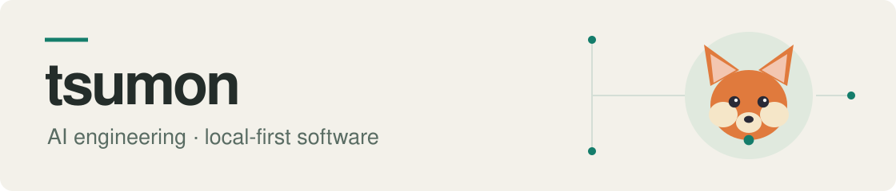

<picture>
  <source media="(prefers-color-scheme: dark)" srcset="./assets/profile-dark.svg" />
  
</picture>

  <strong>Build useful systems. Leave clean diffs.</strong> 
  写一些能跑的东西。

  <a href="#selected-work">Projects</a> ·
  <a href="#upstream-contributions">Contributions</a> ·
  <a href="https://tsumon.github.io">Illustrated LLM guide ↗</a>

I build agent workflows, retrieval tools, and local-first apps. I care about what happens after the demo: explicit controls, reproducible experiments, and changes that can be reviewed.

## Selected work

<table width="100%">
  <tr>
    <td width="50%" valign="top">
      <h3><a href="https://github.com/tsumon/foundry">Foundry</a></h3>
      
A local software-delivery workbench. Review a plan, approve execution, and inspect a local patch before applying it.

      
Go · React · SQLite Source alpha · macOS arm64

    </td>
    <td width="50%" valign="top">
      <h3><a href="https://github.com/tsumon/skill-mcp">skill-mcp</a></h3>
      
A local MCP server that selects skills within a token budget. Keep useful instructions close and context small.

      
TypeScript · MCP · local stdio Up to three SKILL.md skills per selection

    </td>
  </tr>
  <tr>
    <td width="50%" valign="top">
      <h3><a href="https://github.com/tsumon/understanding-lab">Understanding Lab</a></h3>
      
Learn AI by testing your understanding: explain a concept, run a reproducible experiment, then explain it again.

      
TypeScript · bilingual · local-first Early preview

    </td>
    <td width="50%" valign="top">
      <h3><a href="https://github.com/tsumon/reminder-app-ios">Reminder · 循环提醒</a></h3>
      
Recurring reminders that move to the next cycle only after confirmation. Native apps with local storage.

      
SwiftUI · Kotlin / Compose <a href="https://github.com/tsumon/reminder-app-ios">iOS source ↗</a> · <a href="https://github.com/tsumon/reminder-app-android">Android source ↗</a>

    </td>
  </tr>
</table>

### Smaller tools, deeper notes

- **[Suite](https://github.com/tsumon/suite)** / **[StreamDock](https://github.com/tsumon/StreamDock)** — a Windows tray utility and an Emby reverse-proxy panel.
- **[看得见的大模型](https://tsumon.github.io)** — an illustrated, hands-on guide to LLMs, written in Chinese.

## Upstream contributions

Projects where my contributions have been merged upstream, with merged PRs linked for each project. The full history is preserved below.

| Project | Merged work |
| :--- | :--- |
| **[WeKnora](https://github.com/Tencent/WeKnora)** | Preserve native OpenRouter reasoning settings when legacy defaults are present. [#3807](https://github.com/Tencent/WeKnora/pull/3807) |
| **[CowAgent](https://github.com/zhayujie/CowAgent)** | MCP and skill configuration in web / desktop consoles [#3155](https://github.com/zhayujie/CowAgent/pull/3155); optional Agent Mail Docker Compose profile [#3236](https://github.com/zhayujie/CowAgent/pull/3236). |
| **[MaxKB](https://github.com/1Panel-dev/MaxKB)** | Skip degraded tool records for workflow tools. [#7182](https://github.com/1Panel-dev/MaxKB/pull/7182) |
| **[OpenHands](https://github.com/OpenHands/OpenHands)** | Align the README's Node.js requirement with the package configuration. [#17410](https://github.com/OpenHands/OpenHands/pull/17410) |
| **[Open WebUI](https://github.com/open-webui/open-webui)** | Improve Simplified Chinese translations. [#30043](https://github.com/open-webui/open-webui/pull/30043) |
| **[p5.js](https://github.com/processing/p5.js)** | Parse p5.strands callback parameters and bodies from the AST. [#9188](https://github.com/processing/p5.js/pull/9188) |

<strong>Full contribution log</strong> · merged &amp; in review · updated daily

External PRs, grouped by outcome and repository. Statuses are synced from GitHub; open PRs are not presented as merged contributions.

<table width="100%">
  <tr>
    <th width="260">Repository</th>
    <th width="610" align="center">Contribution</th>
    <th width="180">Status</th>
  </tr>
  <!-- contribution-log:rows:start -->
  <tr>
    <td colspan="3" align="center"><strong>MERGED</strong> landed upstream</td>
  </tr>
  <tr>
        <td><a href="https://github.com/1Panel-dev/MaxKB">1Panel-dev/ <strong>MaxKB</strong></a></td>
        <td>fix: skip degraded tool record for workflow tools (#7053)</td>
        <td></td>
      </tr>
  <tr>
        <td><a href="https://github.com/OpenHands/OpenHands">OpenHands/ <strong>OpenHands</strong></a></td>
        <td>README Node.js 版本与 engines.node 对齐。</td>
        <td></td>
      </tr>
  <tr>
        <td><a href="https://github.com/open-webui/open-webui">open-webui/ <strong>open-webui</strong></a></td>
        <td>简体中文 i18n 翻译改进。</td>
        <td></td>
      </tr>
  <tr>
        <td><a href="https://github.com/processing/p5.js">processing/ <strong>p5.js</strong></a></td>
        <td>修复 p5.strands 单参数箭头函数解析，解决 <a href="https://github.com/processing/p5.js/issues/9180">#9180</a>。</td>
        <td></td>
      </tr>
  <tr>
        <td><a href="https://github.com/Tencent/WeKnora">Tencent/ <strong>WeKnora</strong></a></td>
        <td>OpenRouter 旧版默认 thinking_control 不再覆盖原生 reasoning 设置。</td>
        <td></td>
      </tr>
  <tr>
        <td><a href="https://github.com/zhayujie/CowAgent">zhayujie/ <strong>CowAgent</strong></a></td>
        <td>控制台侧栏版本号一键源码更新，修 <a href="https://github.com/zhayujie/CowAgent/issues/3148">#3148</a>。</td>
        <td></td>
      </tr>
  <tr>
        <td><a href="https://github.com/zhayujie/CowAgent">zhayujie/ <strong>CowAgent</strong></a></td>
        <td>Web / 桌面配置 MCP 和 skills，修 <a href="https://github.com/zhayujie/CowAgent/issues/3114">#3114</a>。</td>
        <td></td>
      </tr>
  <tr>
        <td><a href="https://github.com/zhayujie/CowAgent">zhayujie/ <strong>CowAgent</strong></a></td>
        <td>钉钉收文件，交给 agent。</td>
        <td></td>
      </tr>
  <tr>
        <td><a href="https://github.com/zhayujie/CowAgent">zhayujie/ <strong>CowAgent</strong></a></td>
        <td>钉钉流式 markdown 卡片。</td>
        <td></td>
      </tr>
  <tr>
        <td><a href="https://github.com/zhayujie/CowAgent">zhayujie/ <strong>CowAgent</strong></a></td>
        <td>LLM 流式输出期间探测 steer inbox。</td>
        <td></td>
      </tr>
  <tr>
        <td><a href="https://github.com/zhayujie/CowAgent">zhayujie/ <strong>CowAgent</strong></a></td>
        <td>feat(docker): add optional Agent Mail compose profile</td>
        <td></td>
      </tr>
  <tr>
        <td><a href="https://github.com/zhayujie/CowAgent">zhayujie/ <strong>CowAgent</strong></a></td>
        <td>fix: keep tool-call breadcrumb through context compaction</td>
        <td></td>
      </tr>
  <tr>
    <td colspan="3" align="center"><strong>IN REVIEW</strong> awaiting maintainer review</td>
  </tr>
  <tr>
        <td><a href="https://github.com/666ghj/BettaFish">666ghj/ <strong>BettaFish</strong></a></td>
        <td>PDF 导出文件名防路径穿越。</td>
        <td></td>
      </tr>
  <tr>
        <td><a href="https://github.com/anthropics/anthropic-sdk-python">anthropics/ <strong>anthropic-sdk-python</strong></a></td>
        <td>fix(streaming): keep stop_* when a later message_delta omits them</td>
        <td></td>
      </tr>
  <tr>
        <td><a href="https://github.com/anthropics/sandbox-runtime">anthropics/ <strong>sandbox-runtime</strong></a></td>
        <td>区分 whichSync 超时与二进制不存在。</td>
        <td></td>
      </tr>
  <tr>
        <td><a href="https://github.com/anthropics/sandbox-runtime">anthropics/ <strong>sandbox-runtime</strong></a></td>
        <td>仅当正文实际变化时才保留 Content-Length 处理。</td>
        <td></td>
      </tr>
  <tr>
        <td><a href="https://github.com/anthropics/sandbox-runtime">anthropics/ <strong>sandbox-runtime</strong></a></td>
        <td>feat: deny unlink/rename inside write-allowed paths</td>
        <td></td>
      </tr>
  <tr>
        <td><a href="https://github.com/huggingface/huggingface_hub">huggingface/ <strong>huggingface_hub</strong></a></td>
        <td>将 concepts/git_vs_http 翻译为简体中文。</td>
        <td></td>
      </tr>
  <tr>
        <td><a href="https://github.com/processing/p5.js">processing/ <strong>p5.js</strong></a></td>
        <td>docs: 将 @tsumon 加入 p5.js 代码贡献者名单。</td>
        <td></td>
      </tr>
  <tr>
        <td><a href="https://github.com/stablyai/orca">stablyai/ <strong>orca</strong></a></td>
        <td>Dashboard 别把还活着的 structured chat 当成死终端。</td>
        <td></td>
      </tr>
  <tr>
        <td><a href="https://github.com/stablyai/orca">stablyai/ <strong>orca</strong></a></td>
        <td>修复 git username 探测超时时静默丢失前缀。</td>
        <td></td>
      </tr>
  <tr>
        <td><a href="https://github.com/Tencent/WeKnora">Tencent/ <strong>WeKnora</strong></a></td>
        <td>修复 Lite 启动时未加载 .env 配置，并保留 ENV_FILE 与进程变量优先级。</td>
        <td></td>
      </tr>
  <tr>
        <td><a href="https://github.com/Tencent/WeKnora">Tencent/ <strong>WeKnora</strong></a></td>
        <td>fix(skills): explain unfederated skills.sh imports</td>
        <td></td>
      </tr>
  <tr>
        <td><a href="https://github.com/Tencent/WeKnora">Tencent/ <strong>WeKnora</strong></a></td>
        <td>fix(kb-delete): give wiki cleanup its own longer timeout budget</td>
        <td></td>
      </tr>
  <!-- contribution-log:rows:end -->
</table>

---

<picture>
  <source media="(prefers-color-scheme: dark)" srcset="https://raw.githubusercontent.com/tsumon/tsumon/output/github-contribution-grid-snake-dark.svg" />
  
</picture>

  <a href="https://github.com/tsumon?tab=repositories">All repositories</a>
  · <a href="https://tsumon.github.io">Read the guide</a>
  · <a href="https://github.com/tsumon/tsumon/issues">Say hello</a>

